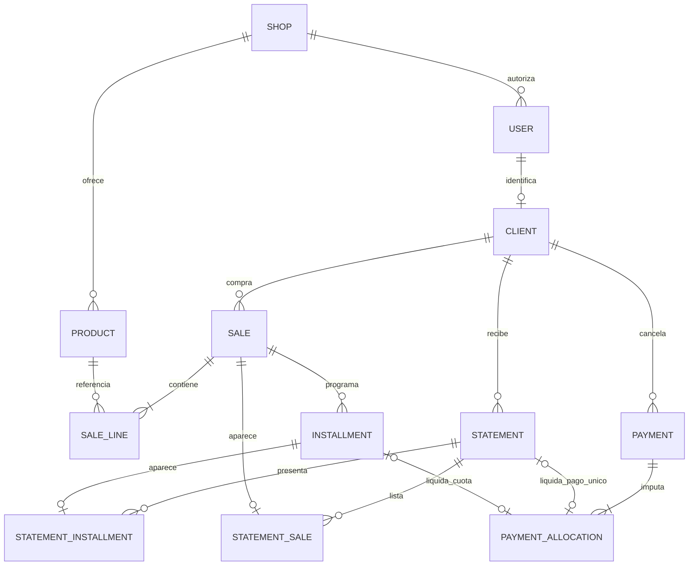

# Evidencia técnica y guion de demostración

## Diseño de datos

| Entidad PostgreSQL | Datos de entrada o relación | Datos de salida o control |
|---|---|---|
| `shops`, `users` | Zona IANA, usuario, perfil y pertenencia | Estado activo, hash y alcance de acceso |
| `products`, `clients` | Imagen, unidad y precios `NUMERIC(18,2)`. Moneda, límite, plazo, corte local, pago y tasas originales por cliente | Catálogo habilitado y condiciones validadas |
| `sales`, `sale_lines` | Cliente, productos, fecha, modalidad y cantidades | Condiciones pactadas, precios históricos, capital original y pendiente, gracia, interés y vencimiento |
| `installments` | Venta mensual | Número, vencimiento, saldo inicial, compensatorio, amortización, pago y saldo final |
| `statements`, `statement_sales`, `statement_installments` | Cliente, ciclo, moneda, compras y cuotas | Estado al corte, base de pago único e intereses por obligación |
| `payments`, `payment_allocations` | Cliente, fecha, importe recibido, liquidación confirmada y clave de reintento | Comprobante y desglose de mora, compensatorio y capital por obligación |

## Cálculo y transacciones

1. Convertir el instante de compra a la zona de la tienda. Compararlo con el corte pactado del mes, ajustando su día si el mes es corto. Si el instante es posterior, avanzar al siguiente corte. Buscar el primer día de pago pactado posterior al día de ese corte. Comparar la venta con el crédito disponible bajo bloqueo del cliente al confirmar.
2. Para pago único, calcular el interés entre compra y vencimiento en días calendario. Para mensual, capitalizar ese mismo tramo como gracia inicial y calcular las cuotas a 30 días comerciales con el método francés. Las fechas de cuota usan el día pactado original. La última liquida el saldo restante.
3. Convertir tasas en `Decimal`. Para una efectiva `e` de `b` días, el factor es `(1+e)^(d/b)`. Para nominal anual `j` con capitalización cada `c` días, es `(1+j*c/360)^(d/c)`. Los cálculos usan al menos 55 dígitos de precisión de trabajo. Los importes se registran a céntimos con `ROUND_HALF_UP`. La gracia capitalizada integra el capital comprometido de una venta mensual.
4. Tras el instante inclusivo de corte, emitir una vez el estado para cada cliente, moneda y vencimiento con movimientos. Reutilizar ese estado si se repite el proceso. Para el cobro, sumar la mora redondeada de cada obligación vencida. La obligación de pago único es el agregado impago del estado, y la de la modalidad mensual es cada cuota. La base comprende capital e interés programado.
5. Bajo bloqueo del cliente, buscar primero la clave de reintento y, si es nueva, volver a liquidar. Exigir el monto completo y guardar los importes imputados en el orden mora, compensatorio y capital. Reducir el saldo únicamente por el capital aplicado y confirmar toda la operación en una transacción. Si falla una escritura, revertir la operación.

## Demostración SI642

Usa fecha de corte 20 a las 18:00, pago pactado el 26 y zona `America/Lima`. Para distinguir historiales, usa un cliente ficticio distinto por escenario.

| Recorrido | Acción y resultado esperado |
|---|---|
| Francés mensual del PDF | Compra el 15/09/2026. Ver 11 días de gracia capitalizada y las tres cuotas del 26/10, 26/11 y 26/12. |
| Francés mensual posterior al corte | Compra el 21/09/2026. Ver 35 días de gracia hasta el 26/10 y primera cuota el 26/11. |
| Pago único, antes, al corte y después | Registrar tres compras de PEN 100, el 15/09, el 20/09 a las 18:00 y el 21/09. Al consultar el 27/09, el estado anterior contiene las dos primeras compras ordenadas. Con TEA compensatoria 24 % y moratoria 30 %, muestra PEN 200 de capital, PEN 1.02 de compensatorio y PEN 0.15 de mora. |
| Cobranza | Intentar ingresar PEN 100 y comprobar el rechazo. Ingresar PEN 201.17, mostrar comprobante y verificar que se liberaron PEN 200. La tercera compra mantiene PEN 100 pendientes. |
| Acceso y persistencia | Entrar como cliente, verificar su propio estado y comprobante. Entrar al otro comercio y comprobar que no aparece esa operación. Reiniciar y consultar de nuevo. |

## Material para la exposición

| Bloque | Pantalla o evidencia | Duración sugerida |
|---|---|---|
| Problema de Bodegas Gloria y solución multiestablecimiento | Inicio, Tiendas y perfiles | 2 min |
| Datos y cálculo | Clientes, cronograma del PDF y venta mensual posterior al corte | 4 min |
| Corte y pago único | Cuentas por cobrar, compras ordenadas, pago parcial rechazado, comprobante y crédito liberado | 5 min |
| Arquitectura y verificación | Modelo ER, migraciones, ejecución de pruebas y recuperación tras reinicio | 3 min |
| Cierre | Reportes y bitácora de uso de IA completada por el equipo | 1 min |

Las convenciones corresponden al enunciado SI642, pp. 2–3 y Anexo A. Las pruebas semanales conservan las 16 filas de las tres simulaciones del informe del Grupo 3 como evidencia del avance anterior.
